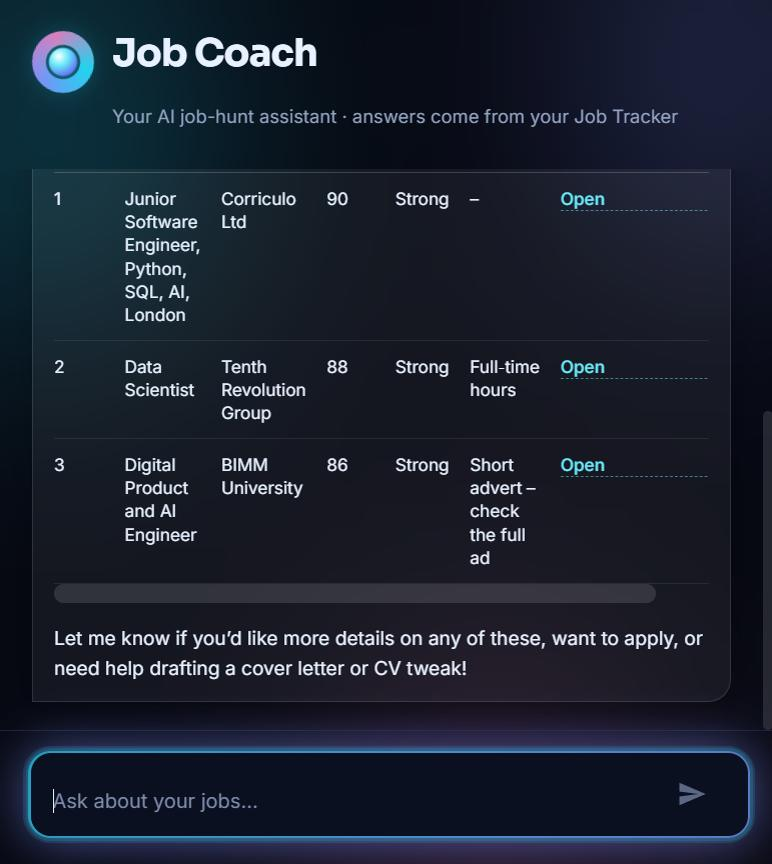
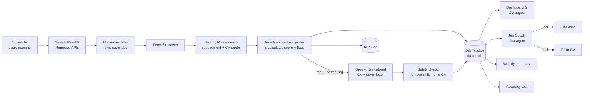
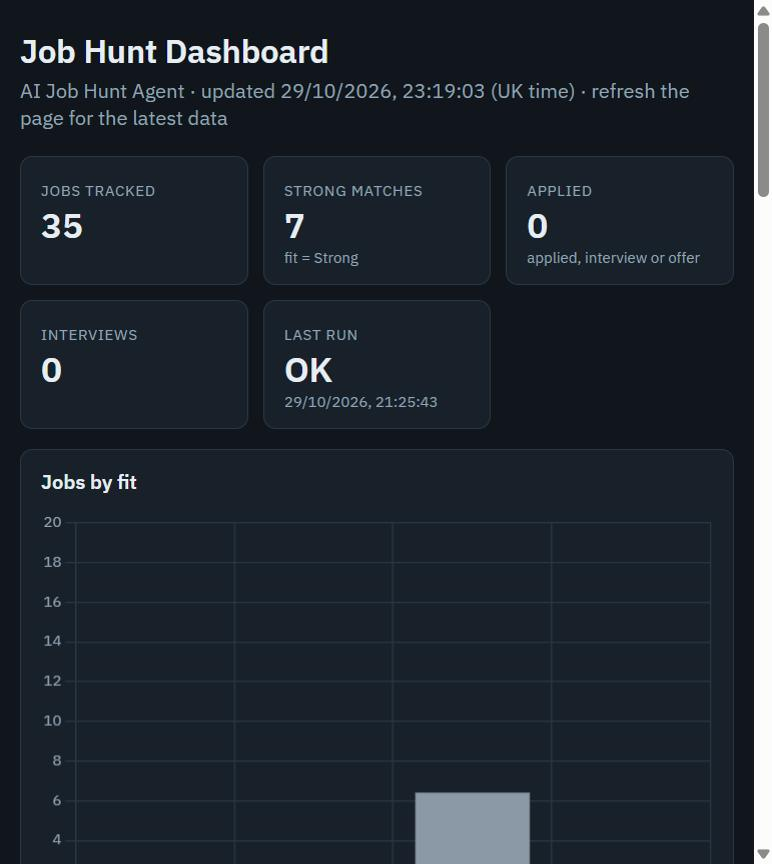
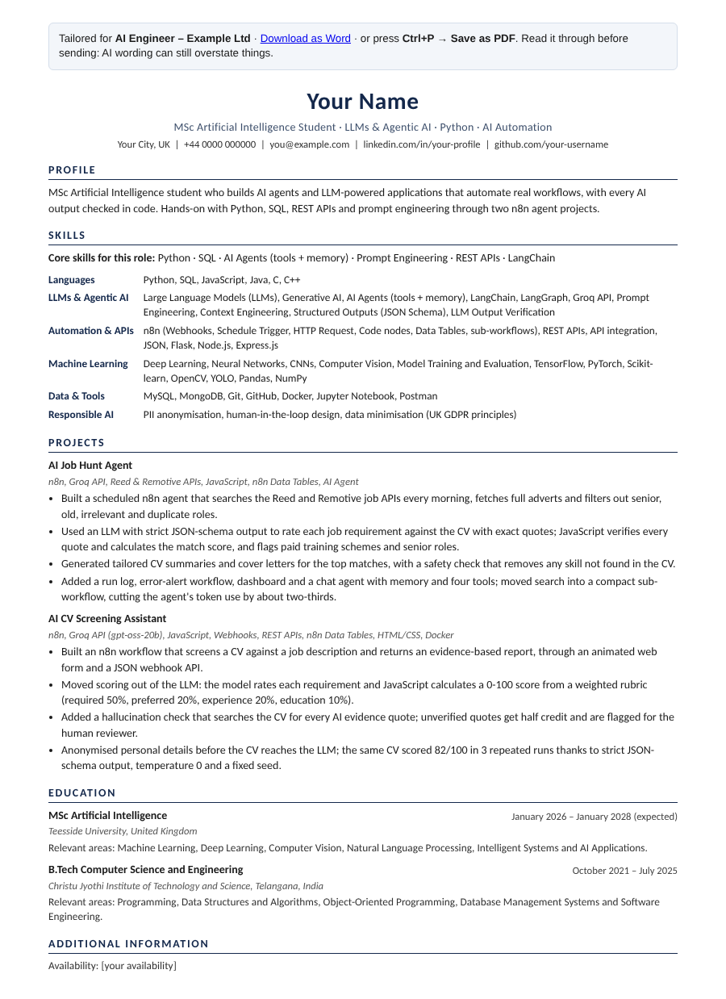

# AI Job Hunt Agent (n8n + Groq)

An AI agent that finds UK job adverts every morning, scores each one against a CV with **verifiable evidence**, flags risky adverts (paid "training schemes", senior roles), and writes a tailored CV and cover letter for the best matches — without inventing anything. A chat assistant lets you query and update your job tracker in plain English.

It **never applies to jobs automatically**. It finds, scores and prepares; a human decides.

---

## What it does

| | |
|---|---|
| **Finds jobs** | Searches the Reed and Remotive job APIs on a schedule, fetches the full advert and drops senior, old, irrelevant and duplicate roles. |
| **Scores jobs in code** | An LLM rates each requirement as *met / partial / not shown* and must quote the CV as evidence. JavaScript checks every quote really exists in the CV and calculates the 0–100 score. |
| **Flags risky adverts** | Paid course / "trainee" recruiter schemes, senior roles, high-salary roles needing years of experience, non-technical roles and clearance requirements. |
| **Tailors the CV** | For the top matches, writes a tailored summary, skills order, project bullets and a cover letter. A safety check removes any skill that is not in the real CV. |
| **CV pages + Word** | Clean one-page tailored CV for each job, viewable in the browser, printable to PDF or downloadable as Word. |
| **Job Coach chat** | An AI agent with memory and 5 tools: find jobs, get job details, update status, check agent health, tailor a CV for any job on request. |
| **Monitoring** | Run log for every run, error-alert workflow, dashboard and a weekly summary. |
| **Learns from feedback** | Companies you keep skipping are blocked; categories with many skips and no positives are paused. |
| **Accuracy test** | Compares the agent's ratings with your own ratings and reports agreement, precision and recall. |

## Results

Measured on 19 real job adverts labelled by hand (`Strong / Possible / Weak / Red flag`):

| Metric | Before rule fixes | After rule fixes |
|---|---|---|
| Exact rating agreement | 63% | **84%** |
| "Apply or not" agreement | 68% | **89%** |
| Precision of "apply" picks | 60% | **100%** |
| Strong matches found | 5 / 5 | 5 / 5 |

> Honest caveat: the rule fixes (trainee schemes, senior and non-technical roles) were designed after looking at these same 19 adverts, so the "after" numbers are optimistic. A fair re-test on newly found adverts is the next step.

## How it works

### Why the score is calculated in code, not by the LLM

LLMs are inconsistent at producing numbers and can invent evidence. Here the model only classifies each requirement and quotes the CV. The code then:

- gives essential requirements weight 2 and desirable ones weight 1;
- gives full credit for *met*, half for *partial*, none for *not shown*;
- **searches the CV for every quote** — a quote that is not found gets half credit and is flagged as a possible hallucination; *met* with no quote gets nothing;
- subtracts points for 2+ / 3+ years' experience, senior roles and £60k+ salaries;
- caps senior and non-technical roles at *Weak* and marks paid-training schemes as *Red flag*.

### Honesty safeguards

- The tailoring prompt may only reorder and reword facts already in the CV.
- Code removes any "top skill" that does not appear in the CV.
- Summaries must be in CV style (no "I / my"), must not name the company, and must not claim abilities the CV does not show.
- Contact details are added by code, never by the model.
- Every page reminds the user to read the CV before sending.

## Screenshots

| Dashboard | Tailored CV page |
|---|---|
|  |  |

## Workflows

| File | Workflow | Trigger |
|---|---|---|
| `01-ai-job-hunt-agent.json` | Main agent: search, score, tailor, save, log | Every morning + manual |
| `02-error-alert.json` | Logs failed runs to the Run Log | Error trigger |
| `03-job-coach-chat-agent.json` | Job Coach chat agent (hosted chat page) | Chat |
| `04-job-coach-tool-find-jobs.json` | Tool: compact job search (title or company) | Called by agent |
| `05-job-coach-tool-tailor-cv.json` | Tool: tailor CV + cover letter for one job | Called by agent |
| `06-dashboard-and-cv-pages.json` | Dashboard and tailored CV pages | Webhooks `/job-dashboard`, `/job-cv` |
| `07-word-downloads.json` | Word (.docx) download of CV / cover letter | Webhook `/tailored-cv` |
| `08-interview-prep.json` | Interview prep notes for jobs at interview stage | Every 30 minutes |
| `09-weekly-summary.json` | Weekly stats row | Sunday evening |
| `10-accuracy-test.json` | Compares agent ratings with your own | Manual |

## Tech stack

n8n (self-hosted in Docker) · Groq API (`openai/gpt-oss-20b` for scoring and tailoring, `openai/gpt-oss-120b` for the chat agent) · Reed Jobs API · Remotive API · JavaScript (Code nodes) · n8n Data Tables · n8n AI Agent with tools and memory · HTML/CSS.

## Setup

1. **Run n8n** (tested on n8n 2.x in Docker).
2. **Create credentials** in n8n:
   - `Reed API` — *Basic Auth*, username = your Reed API key, empty password.
   - `Header Auth account` — *Header Auth*, name `Authorization`, value `Bearer <your Groq API key>`.
   - `Groq account` — n8n's Groq credential (used by the chat model).
3. **Create the data tables** (Overview → Data tables):
   - **Job Tracker**: `job_id, title, company, location, salary, source, search_category, url, posted, fit, why_fit, missing, flags, tailored_cv, cover_letter, status, interview_prep, my_fit` (text) and `match_score` (number).
   - **Run Log**: created automatically by the *Create Run Log table* button in `02-error-alert`.
   - **Weekly Summary**: created automatically by `09-weekly-summary`.
4. **Import the workflows** in order (01 → 10). After importing, open each node that shows a warning and re-select the credential, data table or sub-workflow (IDs are not portable between n8n instances).
5. **Add your own CV**: replace the example CV text in *Build Match Requests* (01), *Build Tailoring Request* (05), *Build Prep Requests* (08), the `ME` object in *Build Tailored CV* (06) and *Build Word File* (07), and the fixed facts in the chat agent's system message (03).
6. **Set your search** in the *Search Plan* node (keywords, location, distance).
7. **Publish** the tool workflows (04, 05) first, then the rest. Set `02-error-alert` as the error workflow of `01`.
8. Open the chat from the Chat node, or visit `/webhook/job-dashboard` for the dashboard.

## Limitations

- Runs locally, so scheduled runs only happen while the machine and Docker are on.
- Groq's free tier allows about 8,000 tokens per minute; calls are spaced 30 seconds apart and retried, so a run takes a few minutes.
- The accuracy result is based on a small, hand-labelled sample.
- LinkedIn has no public jobs API; LinkedIn job alerts via email are a possible future source.

## Author

**Jyothika Kokkula** — MSc Artificial Intelligence student  
[LinkedIn](https://www.linkedin.com/in/jyothikakokkula) · [GitHub](https://github.com/kokkulajyothika)

Related project: [AI CV Screening Assistant (n8n)](https://github.com/kokkulajyothika/AI-CV-Screening-n8n)
